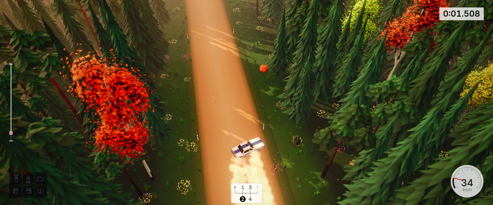
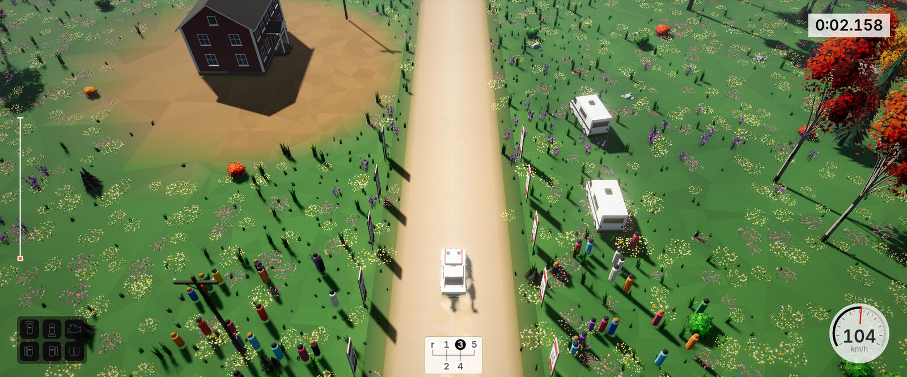
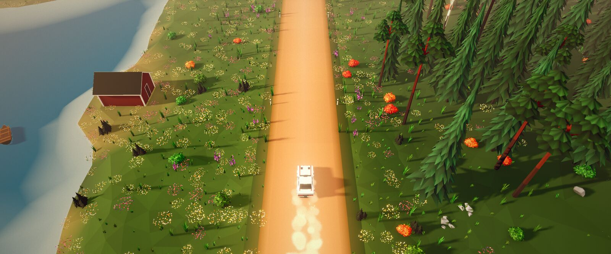
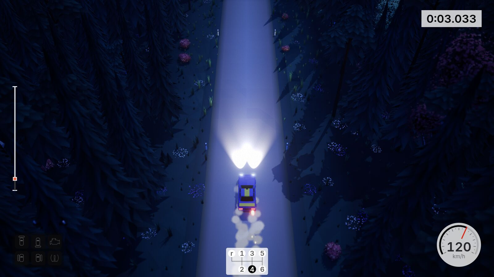
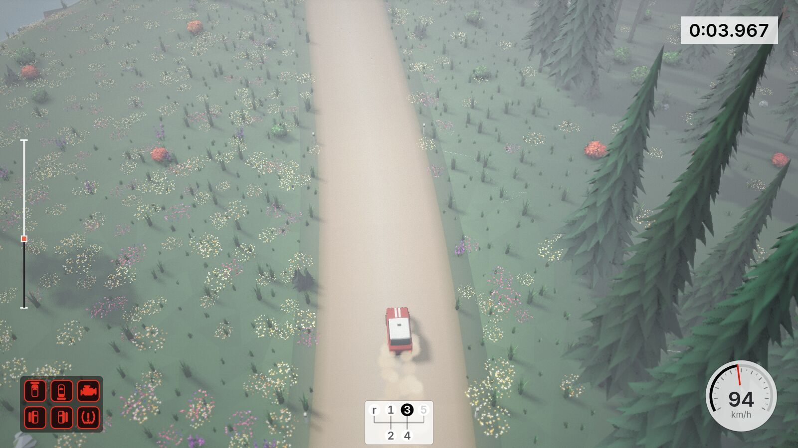

# backroad rally

<p align="center">
  <a href="https://jason-c-dev.github.io/backroad-rally/"></a>
  &nbsp;
  <a href="https://github.com/jason-c-dev/backroad-rally/issues/new"></a>
</p>

> [!TIP]
> **Notice a bug, or would like to see something more in the game?** Please
> [raise an issue](https://github.com/jason-c-dev/backroad-rally/issues/new). Claude will consider all requests. 

[](https://jason-c-dev.github.io/backroad-rally/)
[](https://github.com/jason-c-dev/backroad-rally/actions/workflows/pages.yml)

[](LICENSE)


[](https://claude.com/claude-code)
[](https://github.com/jason-c-dev/backroad-rally/commits/main)

A small top-down rally game with a diorama look, for the browser. It is a free,
open-source, non-commercial demo, made in eleven vertical slices. It has five cars from
four eras, six point-to-point stages, five times of day, rain and snow, and a short
career against nine simulated rivals, who also race as ghosts.

## Made with Claude Code and other apps

An AI coding agent, [Claude Code](https://claude.com/claude-code) with Claude Opus 5.5,
wrote almost all of this game. First it made a desktop version in Unreal Engine 5, in
about four days. Then it ported that game to the web. One developer gave the ideas, made
the decisions and played every build. [The making-of](docs/making-of/README.md) tells
how.

- [Claude Code](https://claude.com/claude-code) (Anthropic): the agent that wrote the code
  and ran every tool
- [Unreal Engine 5](https://www.unrealengine.com/) (Epic Games): the first, desktop version,
  in C++
- [Blender](https://www.blender.org/): all the meshes, from Python scripts that run headless
- [ElevenLabs](https://elevenlabs.io/): sound effects and music
- [three.js](https://threejs.org/), [Rapier](https://rapier.rs/), [Vite](https://vite.dev/)
  and TypeScript: the web version
- [GitHub Pages](https://pages.github.com/): the published game
- The developer's workspace: [Omarchy](https://omarchy.org/), [Herdr](https://herdr.dev/) for the
  agent panes, the [claude-code-status](https://github.com/jason-c-dev/claude-code-status) status
  line and the [savvy-progress](https://github.com/johnnyvizz/claude-kit/tree/main/plugins/savvy-progress)
  agents panel. [How the developer works with Claude](docs/making-of/02-the-tools.md#how-the-developer-works-with-claude)
  tells more.

## Screenshots







| | |
|---|---|
|  |  |

## How to play

Play in the browser: **<https://jason-c-dev.github.io/backroad-rally/>**

The game opens on the title screen. Choose career, quick stage or time attack, then a
car and a stage. In time attack you race the ghost of your best run. The menus work with the keyboard, the mouse or a gamepad.

| Key | Action |
|---|---|
| W / S | Throttle / brake |
| A / D | Steer |
| Space | Handbrake |
| R | Recover (+5 s) |
| Esc | Pause menu (resume, restart, recover, settings, quit) |
| Enter | Restart the stage |
| C | Camera |
| M | Mute |

A gamepad also works: the triggers, the left stick, L1 for the handbrake, Y to recover
and Start to pause. The [reference](docs/reference.md#keys-and-gamepad) has all the keys and URL
options.

**Now in the game:**

- **Career:** four seasons from the 1960s to the 1990s, four rallies of two stages each,
  against nine rivals. Points, standings, restarts, damage that stays between the stages
  of a rally, and new groups, cars and bonus liveries to unlock.
- **Ghosts:** race the ghost of your best run, with the time gap on the HUD, and the rival
  ghosts with their names and your live position.
- **Menus:** a title screen over a live diorama, a garage with the spec sheet of each car,
  a stage select with the time of day, the weather and your best time, pause, results and
  settings (assists, camera, every volume, graphics quality, frame-rate limit). Best times,
  ghosts and the career stay in your browser.
- **Six stages:** finland, japan, alps, wales, arizona and vermont, about
  3 km each, with jumps, bridges, a ford, a canyon and crowds. Each runs forward or in reverse.
- **Five cars:** swift and pip (1960s, rear-wheel and front-wheel drive), lama
  (1970s, mid-engine), quint (1980s, four-wheel drive turbo) and kaze (1990s, four-wheel
  drive turbo).
- **Five times of day:** morning, afternoon, sunset, night and fog.
- **Rain and snow:** the grip, the handling, the look, the effects and the sound change
  with the weather. Snow has ice on the tarmac.
- Dust, skid marks, damage, a full HUD, engine sound, crowds and music.
- **Runs on a laptop:** auto quality picks the graphics tier behind the loading screen,
  so the picture does not change or stop when the stage starts. It holds 60 fps on an
  integrated GPU. Chrome (WebGPU or WebGL2) and Firefox (WebGL2) work.
- **Fast updates:** each data file has a content hash in its URL, so a reload after a
  new version gets the new files at once. Models are compressed, and the menus get the
  files for the next stage in the background.

## How AI built this

The game is a port of a desktop game that an AI agent made in four days. A team of
background agents did the work, and each agent had a written brief. 221 automatic
handling checks compare each car with the original, and a robot driver times every
stage.

Ten hard problems needed real fixes. In one, the physics engine could not tell which
triangle a wheel was on. In another, nobody could hear the crowds.

Read the full story, with the token count and the cost:
**[The making-of backroad rally](docs/making-of/README.md)**.

## Development

You need Node 24 or later.

```sh
npm ci
npm run dev             # http://localhost:5173/
npm test                # unit tests
npm run test:handling   # headless handling tests
npm run build           # production build into dist/
```

The [technical reference](docs/reference.md) has the details: URL options, quality
tiers, effects, damage, HUD, audio, tests, asset conversion and browser checks.

## Credits

- Inspired by [art of rally](https://artofrally.com/). This project has no connection
  with its makers.
- Rendering: [three.js](https://threejs.org/) (MIT).
- Physics: [Rapier](https://rapier.rs/) (Apache-2.0).
- Sound effects and music generated with [ElevenLabs](https://elevenlabs.io/).
- Engine and UI sounds are synthesised by the project's own scripts.
- HUD font: [Inter](https://rsms.me/inter/) by The Inter Project Authors (SIL Open Font
  License 1.1, `public/fonts/OFL.txt`).
- Made with [Claude Code](https://claude.com/claude-code).

## Licence

The code is MIT licensed; see [LICENSE](LICENSE). Third-party libraries and fonts keep
their own licences.
