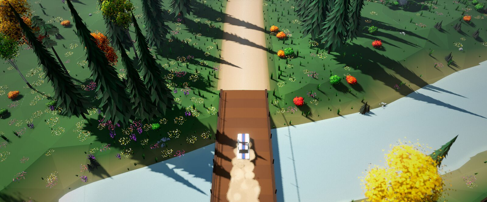

# 1. The idea and the inspiration

[Index](README.md) · Next: [The tools](02-the-tools.md)

## A video and a question

On day 1, the developer saw a video. In the video, Claude Code made a game
with Unreal Engine 5 and Blender. It used no plugins: it found the two applications on
the disk and controlled them from the command line. The developer wanted to know if
the same method could make a good game on Linux.

He prepared his machines for game work on the same day. Then he started a brainstorm
with Claude Code. Before the first line of code, they agreed on these items:

- the type of game and the engine template;
- the scope, the look and the target hardware;
- the method: one feature at a time, with a check after each feature.

## The inspiration: art of rally

The developer chose a rally game. His model was
[art of rally](https://artofrally.com/), a stylised top-down rally game. On day 2
he asked for a game "as close to the original as possible". It must have at least two
tracks, the different car types and a playable run-through.

backroad rally is inspired by art of rally. It copies no names, logos, music or assets.
The rules for the design were these:

- Recreate the style and the systems, not the content.
- Give the cars our own names: swift, pip, lama, quint and kaze.
- Use invented sponsors and flags.
- Make all the music and sound for this game.
- Make all the meshes with our own Blender scripts.

## Research before design

Before the design, three research agents studied the inspiration. They collected 10 to
15 reference screenshots and wrote notes about these subjects:

- the gameplay systems;
- the cars and the stages;
- the art and the technology.

Every later brief about the look said "compare with the reference screenshots".

## The three pillars

The design document gave the game three pillars:

1. **The diorama view.** A high chase camera looks down at a small car on a toy-like
   landscape. The camera is the co-driver: there are no pace notes, and you read the
   road ahead.
2. **Flow and commitment.** Flicks, slides, crests and jumps. The handling is
   arcade-friendly and rewards weight transfer, the handbrake and the throttle.
3. **Calm presentation.** The interface uses lowercase text and few numbers. Nothing
   shouts.

## What the Unreal game contained at the end

| Item | Quantity |
|---|---|
| Cars | 5, from four eras (1960s to 1990s), with 5 liveries each |
| Stages | 6 point-to-point stages of about 3 km, each forward and in reverse |
| Conditions | 5 times of day (morning, afternoon, sunset, night, fog) × 3 weathers (clear, rain, snow) |
| Career | 4 seasons × 4 rallies × 2 stages, against 9 simulated rivals |
| Ghosts | A ghost of your best run, and rival ghosts that race with you |

The six stages are:

- finland: gravel and jumps;
- japan: tarmac hairpins;
- alps: snow and switchbacks;
- wales: wet gravel, stone walls and a ford;
- arizona: desert and a canyon;
- vermont: autumn forest and a covered bridge.

