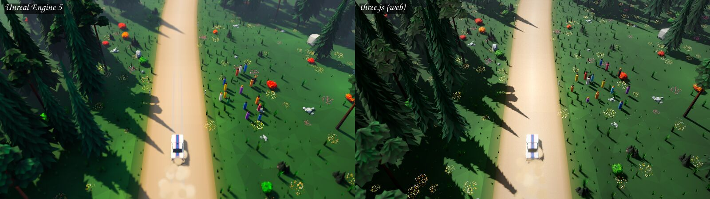
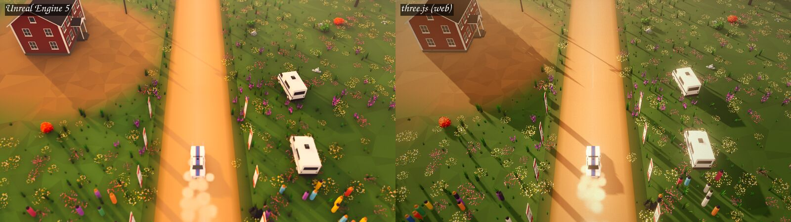
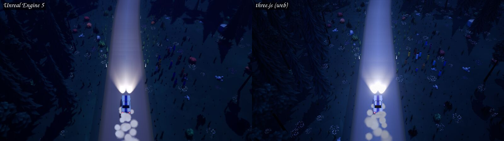

# 4. The port to the web

[Index](README.md) · Previous: [The Unreal Engine game](03-the-unreal-game.md) · Next: [How Claude Code did the work](05-how-claude-code-worked.md)

## Why the browser

The Unreal game ran well, but only as a large packaged build on Linux. On 14 October
2026 the developer decided to make a version that anybody can play in a browser, free
and open source. These decisions came first:

- **A separate project.** All web work happens in this repository. The Unreal project
  stays private and local, and is a read-only reference.
- **Public on GitHub Pages**, with the code under the MIT licence.
- **A non-commercial demo.** Thus, the ElevenLabs sound and music can be published,
  with a credit.

## The stack, and why

| Decision | Reason |
|---|---|
| three.js `WebGPURenderer` with TSL node materials | Custom shading (sway, dithered fades, colour grade) is easier in TSL. It falls back to WebGL2 when the browser has no WebGPU. |
| Rapier, single-threaded `-compat` build | GitHub Pages cannot send custom headers. Thus, the page cannot use `SharedArrayBuffer` or multithreaded WebAssembly. |
| Our own raycast vehicle on a Rapier body | The feel of the car is in the tyre model and the "arcade" assists. The game must own both. |
| A fixed 120 Hz physics step, with interpolation for the render | The tests must give the same result on every run. |
| Web Audio, with no library | Engine loops, gain groups and filters are all native nodes. |
| An HTML and CSS HUD over the canvas | A DOM interface is much easier to make than the Slate interface in Unreal. |
| Vite and TypeScript | A fast build, with hashed file names so that each update shows at once |

## Units and axes

The Unreal data uses centimetres and a left-handed frame with Z up. three.js uses
metres and a right-handed frame with Y up. One small module, `src/ue.ts`, converts
positions and rotations when the game loads the data. No other code sees centimetres.
Unit tests check the yaw sign and the rotation order.

## The asset pipeline

The converters read the Unreal project from a path that you give on the command line.
They write web files into this repository, and the output is committed. Thus, the
GitHub build needs no Unreal project.

| Source in the Unreal project | Converter | Web output |
|---|---|---|
| JSON data (cars, tuning, conditions, HUD, audio mix) | `tools/convert/data.mjs` | `public/data/*.json` |
| Blender car generators | `tools/blender/export_car_glb.py` | One GLB for each car, with the wheels as separate nodes |
| Stage `.blend` files | `tools/blender/export_stage_glb.py` | Terrain tiles, backdrop and bridges as GLB |
| Stage JSON (up to 6 MB) | `tools/convert/stage.mjs` | A small JSON file plus a binary file with six floats for each instance |
| Vegetation and props | `tools/blender/export_env_glb.py`, `tools/convert/glb.mjs` | Compressed GLB (welded, quantized, meshopt) |
| WAV and MP3 audio | `tools/convert/audio.mjs` | Ogg Opus, with an AAC copy for effects |

The Blender scripts open the source files as read-only and never save them. For
finland, the stage GLB is 2.57 MB, the plants and props 0.47 MB, the instance data
3.0 MB and the stage JSON 54 kB. The site budget was less than 300 MB in total, and
less than 30 MB before the first stage can start.

## The slices

The port used the same method as the Unreal game: one vertical slice at a time. Each
slice ended with a build, a check and a pull request.

| Slice | Pull request | Merged | Result |
|---|---|---|---|
| Pages | #1 | 15 Oct | Vite scaffold, a placeholder page and the deploy workflow |
| 1. Skeleton | #2 | 15 Oct | Data loader, test strip, one car, chase camera, frame-time HUD |
| 2. Vehicle core | #3 | 15 Oct | Raycast vehicle on Rapier, controls, headless handling tests |
| 3. Arcade layers | #4 | 15 Oct | The assists from the original. All 221 handling checks pass. |
| 4. finland | #5, #6 | 15 Oct | The first real stage, drivable from start to finish, and an autopilot |
| 5. The look | #7 | 15 Oct | Materials, five conditions, height fog, post-processing |
| Performance | #8 | 16 Oct | 60 fps on an integrated GPU |
| 6. Effects and audio | #9 | 16 Oct | Dust, skid marks, spectators, breakables, engine and world sound, music |
| Handling 2 | #11 | 16 Oct | Slides lose speed as in the original; rocks are solid |
| Audio fixes | #12, #13 | 16 Oct | The listener on the car; louder crowds |
| Damage and HUD | #14 | 16 Oct | Damage from physics impulses; the full in-stage HUD |

The dates are in UTC. The [hard problems chapter](07-hard-problems.md) tells what went
wrong in these slices.

## The result so far

The comparisons below show the same stage, at the same spot and with the same camera.
The left half is the Unreal game. The right half is the web game.

## What comes next

The plan has these slices after the current work:

1. All six stages, in both directions, with all five cars (in progress).
2. Weather: rain and snow, with grip, looks, particles and sound.
3. Game flow: menus, garage, stage select, pause, results, settings and saves.
4. Career, the ghost of your best run, and rival ghosts.
5. Performance and polish, and checks in more browsers.
